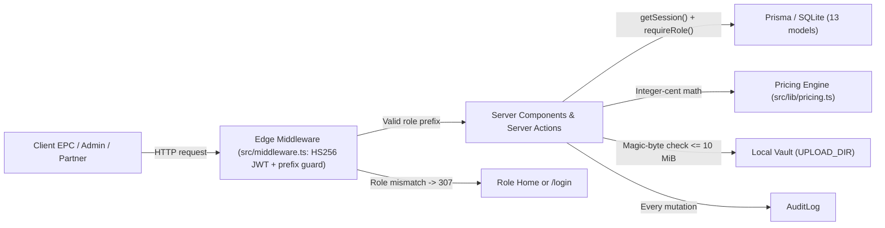
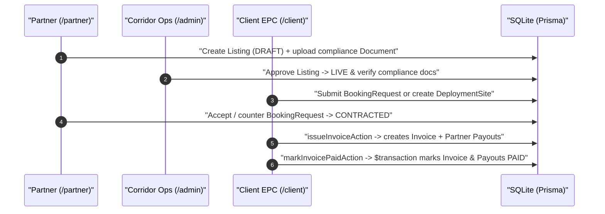

<p align="center">
  
</p>

<p align="center">
  <picture>
    <source media="(prefers-color-scheme: dark)" srcset="docs/banner-dark.svg" />
    
  </picture>
</p>

<p align="center">
  <a href="https://nextjs.org"></a>
  <a href="https://react.dev"></a>
  <a href="https://www.typescriptlang.org"></a>
  <a href="https://www.prisma.io"></a>
  <a href="https://tailwindcss.com"></a>
  <a href="https://zod.dev"></a>
  <a href="https://www.sqlite.org"></a>
</p>

**Corridor** is a fullstack workforce housing and site-logistics marketplace built for European energy, substation, and data-center EPC crews. Built with Next.js 15 App Router Server Actions, Prisma (SQLite locally), Tailwind CSS, Zod, and stateless HS256 JWT sessions, it runs completely locally without external SaaS billing or storage dependencies.

---

## Contents

- [Features](#features)
- [Whitepaper economics](#whitepaper-economics)
- [Architecture](#architecture)
- [Role surfaces](#role-surfaces)
- [Getting started](#getting-started)
- [Environment variables](#environment-variables)
- [Scripts](#scripts)
- [Security and known limitations](#security-and-known-limitations)

---

## Features

| Area | Details |
| :--- | :--- |
| **B2B marketplace & filtering** | Clients browse approved partner housing listings with yard, HGV access, fenced laydown, insured storage, Wi-Fi, sleep capacity, project-type, and max-rate filters at `/client/browse`. |
| **Single pricing engine** | Integer-cent euro math (`src/lib/pricing.ts`) shared across marketing worked examples, interactive `/calculator`, deployments, invoice generation, and payout schedules. |
| **Multi-site deployments & invoicing** | Group sites into `Deployment` engagements, issue itemized invoices creating matching per-partner `Payout` rows, and settle or void inside atomic Prisma `$transaction` blocks. |
| **Compliance vault & accreditation** | Validates PDF, PNG, JPEG, and WebP magic bytes up to 10 MiB (`src/lib/storage.ts`), stores polymorphic `Document` records, and tracks client-partner `VendorAccreditation` workflows. |
| **Role-segregated workspaces** | Separate `/partner`, `/client`, and `/admin` layouts backed by `requireRole()` checks, React 19 `useActionState` Server Actions, and append-only `AuditLog` entries. |

---

## Whitepaper economics

All fees are driven from a single `TakeRateConfig` row (`DEFAULT_PRICING` in `src/lib/pricing.ts`):
- **Partner commission**: `9%` (`900` bps; `hostWaiveFirst90Days` config flag defaults `true`)
- **Enterprise take**: `12%–15%` (`1300` bps / `13%` default, clamped per deployment site)
- **Site SaaS fee**: `€750 / site / month` (`75000` cents)
- **VAT rate**: `19%` (`1900` bps) applied to client subtotal (`gross + enterprise take + SaaS fee`)

Worked scenario (**6 sites × 9 months × 100 crew/site × €1,400/person/month** computed by `computeDeploymentEconomics`):

| Line item | Formula | Value |
| :--- | :--- | :--- |
| **Gross housing spend** | `600 crew × 9 mo × €1,400` | `€7,560,000` |
| **Enterprise take (13%)** | `€7,560,000 × 13%` | `€982,800` |
| **SaaS site fee** | `6 sites × 9 mo × €750` | `€40,500` |
| **Client subtotal (ex-VAT)** | `gross + enterprise take + SaaS` | `€8,583,300` |
| **VAT (19% on client subtotal)** | `€8,583,300 × 19%` | `€1,630,827` |
| **Client total (incl. VAT)** | `subtotal + VAT` | `€10,214,127` |
| **Host commission (9% unwaived)** | `€7,560,000 × 9%` (`€0` when waived) | `€680,400` |
| **Partner net payout** | `gross − host commission` | `€6,879,600` (`€7,560,000` if waived) |
| **Corridor revenue (ex-VAT)** | `enterprise take + host commission + SaaS` | `€1,703,700` (`€1,023,300` if waived) |

> [!NOTE]
> `DEFAULT_PRICING.hostWaiveFirst90Days` is stored on `TakeRateConfig`, while `addDeploymentSiteAction` and `issueInvoiceAction` currently pass `hostIsNewAndWithinWaiver: false` when calculating commissions.

---

## Architecture

Corridor exposes 37 App Router route files (`36` `page.tsx` pages plus `src/app/auth/logout/route.ts`) across 3 role layouts (`/partner`, `/client`, `/admin`) with mutations handled via Next.js Server Actions rather than REST JSON endpoints.



### Supply-to-settlement flow



---

## Role surfaces

Every seeded demo account shares password **`Corridor2026!`** (sign in at `/login`):

| Role | Demo login | Route prefix | Key capabilities |
| :--- | :--- | :--- | :--- |
| **CLIENT** | `client1@corridor.example` (`client1..6`) | `/client` | Browse vetted listings, request bookings, build deployments, issue/pay/void invoices, view accreditations. |
| **PARTNER** | `partner1@corridor.example` (`partner1..6`) | `/partner` | Manage property listings, upload compliance documents, respond to bookings, view payouts and accreditations. |
| **STAFF** | `compliance@corridor.example` | `/admin` | Review listings, verify documents, inspect deployments, payouts, audit logs (`adminAudit(300)`), and accreditations. |
| **ADMIN** | `ops@corridor.example` | `/admin` | Full staff permissions plus `/admin/users` and `/admin/rates` (`TakeRateConfigForm`, restricted via `requireRole("ADMIN")`). |

---

## Getting started

### Prerequisites

- Node.js 20+ and npm (`postinstall` runs `prisma generate`)

### Local installation & seed

```bash
# 1. Install dependencies and generate Prisma client
npm install

# 2. Create local environment file
cp .env.example .env
# Edit .env and set a strong SESSION_SECRET (>= 16 chars)

# 3. Create SQLite schema (prisma/dev.db) and seed 18 sites, 14 users, 7 listings, invoice & payouts
npm run db:migrate
npm run db:seed

# 4. Run development server (http://localhost:3000)
npm run dev
```

For quick authenticated `curl` testing against local routes without using the login UI, mint a `corridor_session` JWT for any seeded user:

```bash
node scripts/mint-token.mjs ops@corridor.example
```

---

## Environment variables

| Variable | Scope | Local development | Production |
| :--- | :--- | :--- | :--- |
| `SESSION_SECRET` | Server / Middleware | Minimum 16 chars in `.env` (`>= 32` random chars recommended) | Required cryptographically random secret |
| `DATABASE_URL` | Prisma | `"file:./dev.db"` (SQLite relative to `prisma/schema.prisma`) | Managed PostgreSQL URL (requires updating Prisma `provider`) |
| `UPLOAD_DIR` | Server Actions | `"./uploads"` (created on write; `.gitkeep` tracked) | Replace `src/lib/storage.ts` with S3/R2 object storage |
| `APP_BASE_URL` | Logout route | `"http://localhost:3000"` (`POST /auth/logout` 303 redirect target) | Canonical production origin URL |
| `NODE_ENV` | Runtime | `"development"` (`secure` cookie false, Prisma query logging on) | `"production"` (`secure` cookie true) |
| `STRIPE_SECRET_KEY` | `.env.example` | Blank (unused in current codebase; invoicing is simulated) | Unused unless Stripe billing is integrated |
| `STRIPE_WEBHOOK_SECRET` | `.env.example` | Blank (unused in current codebase) | Unused unless Stripe billing is integrated |

---

## Scripts

| Command | Description |
| :--- | :--- |
| `npm run dev` | Starts Next.js development server (`next dev`) |
| `npm run build` | Builds production Next.js bundle (`next build`) |
| `npm run start` | Runs compiled Next.js server (`next start`) |
| `npm run lint` | Runs `next lint` |
| `npm run typecheck` | Runs TypeScript check (`tsc --noEmit`) |
| `npm run db:generate` | Generates Prisma Client (`prisma generate`) |
| `npm run db:push` | Pushes schema changes directly to database |
| `npm run db:migrate` | Runs `npm run db:generate && prisma migrate dev --name init` |
| `npm run db:seed` | Seeds SQLite database via `tsx prisma/seed.ts` |
| `npm run db:studio` | Opens Prisma Studio |
| `npm run db:reset` | Resets migrations and database (`prisma migrate reset --force`) |
| `npm run postinstall` | Automatically runs `prisma generate` after `npm install` |

---

## Security and known limitations

- **Local SQLite & disk storage**: Prisma uses `provider = "sqlite"` and `src/lib/storage.ts` writes compliance uploads to `UPLOAD_DIR`. No HTTP download/preview route currently exposes `readUpload()`.
- **Session secret fallback hazard**: In `src/lib/auth.ts`, `getSecret()` falls back to a hardcoded development string whenever `SESSION_SECRET` is missing or shorter than 16 characters — ensure a strong secret is always set before any deployment.
- **Invalid cookie deletion in Server Components**: `getSession()` (`src/lib/session.ts`) calls `store.delete(SESSION_COOKIE_NAME)` when verifying a malformed/expired JWT, which Next.js 15 disallows inside Server Component renders.
- **Action-level RBAC & state-machine gaps**:
  - `can()` (`src/lib/permissions.ts`) computes ownership metadata but returns `u.role === "PARTNER"` unconditionally; most org checks rely on individual Server Actions and `queries.ts`.
  - `uploadDocAction` does not restrict document uploads by role/capability; `updateTakeRateConfigAction` calls `revalidatePath("/admin/take-rate")` instead of `"/admin/rates"`; and `STAFF` navigation links to `/admin/rates` despite `ADMIN` route enforcement.
  - `addDeploymentSiteAction` trusts client-supplied site rates/commission values (clamping only `enterpriseTakeBps`), and booking/deployment status actions lack strict transition validation.
- **No automated test runner**: No unit/E2E test suite or GitHub Actions CI workflow is present in the repository.

---

<p align="center">
  <sub>Corridor · Next.js 15 · React 19 · Prisma 5 · Zod 3 · EPC Workforce Housing</sub>
</p>
